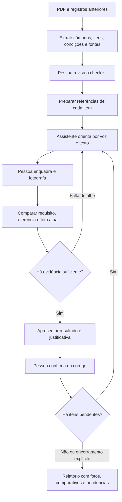
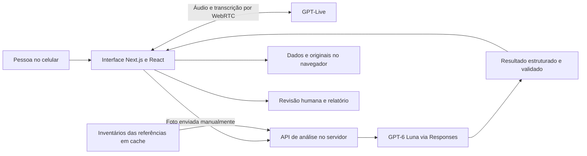

# ChaveCheck — da documentação à vistoria guiada

**Contexto para avaliação do hackathon · 23 de outubro de 2026**  
**Estágio:** prova de conceito funcional, com evolução planejada para uma jornada completa a partir de documentos.

O ChaveCheck quer transformar um PDF de vistoria, contrato ou termo de entrega em um checklist que uma assistente conduz com a pessoa no local. Durante a visita, ela orienta o que mostrar, recebe fotografias, compara o estado atual com os registros anteriores e organiza as evidências. Ao final, o usuário revisa as conclusões e obtém um relatório com imagens, comparativos e a origem de cada requisito.

**A experiência que queremos oferecer:** “Envie a vistoria anterior, abra a câmera e deixe a assistente conduzir a conferência até o relatório.”

A demonstração atual concentra essa experiência em dois itens: a textura de cimento queimado da parede e a condição aparente da canaleta. A conversa por voz e a análise das fotos usam os serviços de IA; o checklist gerado após o upload do PDF ainda é um exemplo fixo. Esta documentação distingue o que já funciona daquilo que será construído.

## 1. O problema e quem queremos ajudar

Uma vistoria reúne informações espalhadas: contrato, laudo anterior, fotos, itens entregues, anotações e a situação observada no imóvel. A pessoa precisa lembrar o que conferir, encontrar a referência correta, fotografar o detalhe e depois reconstruir o contexto para escrever o relatório.

Isso cria quatro dificuldades que orientam o projeto:

- **Cobertura:** lembrar todos os itens previstos, sem encerrar a visita deixando pendências invisíveis.
- **Comparação:** distinguir uma característica original de uma alteração e separar diferença de iluminação de um possível dano.
- **Organização:** registrar a fotografia junto do cômodo, item, condição esperada e observação que motivou a captura.
- **Explicação:** permitir que outra pessoa entenda por que uma conclusão foi registrada e quais evidências a sustentam.

O usuário primário é quem realiza a vistoria com o celular. Imobiliárias, administradores de imóveis, locadores, locatários e responsáveis por conferir reparos são públicos de aplicação. A hipótese de valor é reduzir esquecimentos e trabalho de organização posterior. O projeto ainda não mediu redução de tempo, retorno financeiro ou adoção por esses públicos.

## 2. Como a ideia evoluiu

O projeto nasceu como **Vistoria Viva**, descrito na [especificação inicial](especificacao-original.md). A concepção aproxima a vistoria do conferimento entre o que foi combinado e o que foi entregue. Quantidade, prazo e valor podem ser comparados objetivamente; a fotografia acrescenta a condição visual e o contexto do local.

O ChaveCheck materializou essa proposta em uma aplicação web e refinou o fluxo a partir dos testes da equipe:

| Decisão de produto | Motivo | Resultado na versão atual |
| --- | --- | --- |
| A assistente conduz um item por vez | Evitar perguntas amplas e orientar uma ação concreta | Pedido de enquadramento, captura, revisão e próximo item |
| A pessoa toca para enviar cada foto | Tornar claro quando uma imagem vira evidência | Botão **Fotografar e analisar**, com original preservado |
| Referências recebem um inventário próprio | Explicar o que foi reconhecido na condição anterior | Regiões, acabamento, marcas e condições aparentes registrados |
| Resultado visual e decisão humana ficam separados | Permitir corrigir ou manter uma conclusão inconclusiva | Sugestão da IA e confirmação na interface, com histórico |
| Áudio continua durante a análise | A espera da foto não deve paralisar a conversa | Sessão de voz independente do processamento visual |
| A demonstração ficou em parede e canaleta | Validar uma interação completa e simples antes de ampliar o escopo | Dois itens, duas fotos de referência e relatório ao final |

O cenário curto é o recorte da prova de conceito. A visão de produto abrange documentos, vários cômodos e diferentes tipos de verificação.

## 3. A jornada completa que queremos entregar

O diagrama representa a **jornada alvo**. A extração real do PDF, a revisão do checklist extraído e a importação genérica de fotos anteriores são etapas futuras. A pessoa também pode encerrar uma verificação insuficiente mantendo-a inconclusiva, sem entrar em um ciclo obrigatório de recapturas.

### Antes da visita: transformar o documento em roteiro

A pessoa envia o PDF do laudo anterior, contrato, termo de entrega ou anexo de reparos. O sistema deverá preservar o original e extrair os ambientes, os itens verificáveis, as condições descritas e, quando existirem, quantidades, valores e datas. Cada informação deverá indicar o documento, a página e o trecho de origem. O previsto no contrato e o informado no registro de entrega devem permanecer como fontes distintas, vinculadas ao mesmo item para comparação.

Fotografias contidas no documento ou anexadas separadamente deverão ser relacionadas aos itens. Quando a associação não estiver clara, a interface deverá pedir revisão. Ausência de informação permanecerá como “não informado”; conflitos entre documentos serão apresentados à pessoa antes da inspeção.

O resultado dessa etapa será um checklist revisável, organizado por cômodo. A pessoa poderá corrigir a extração, agrupar itens e retirar duplicidades antes de iniciar.

### Durante a visita: conduzir, capturar e comparar

Ao entrar em um cômodo, a pessoa habilita a câmera e a assistente começa a orientar por voz. O roteiro determina o próximo item. A assistente explica qual detalhe precisa aparecer na foto: a textura da parede, uma emenda da canaleta ou uma vista que permita conferir a quantidade de elementos.

A captura manual salva a imagem e inicia sua análise. A conversa continua disponível durante esse processamento. Quando a imagem não permite decidir, a próxima orientação deve dizer o que falta e como obtê-lo: aproximar, mudar o ângulo, incluir uma extremidade ou evitar reflexo.

Aqui, **tempo real** significa condução por voz e texto durante a visita, com atualização do estado e análise das fotos enviadas. Na versão atual, a câmera apresenta uma prévia local e cada envio depende do toque da pessoa. Não há inspeção automática contínua do vídeo.

Uma sugestão visual deverá explicar o que foi comparado e qual foi a evidência. A pessoa confirma ou corrige o resultado antes de avançar. Funcionamento, medidas, valores e causas de problemas exigem a fonte ou a confirmação apropriada; não devem ser deduzidos de uma aparência.

### Depois da visita: entregar um registro compreensível

O relatório deverá permitir a leitura rápida do resultado e a consulta detalhada de cada item. Quem recebe o documento deve conseguir identificar o previsto, o observado, as imagens utilizadas, a revisão realizada e o que permaneceu pendente.

Encerrar uma visita e aprovar todos os itens são decisões distintas. O relatório preserva divergências, itens inconclusivos e itens não verificados.

## 4. O que está implementado hoje

Esta matriz descreve a versão local documentada em 23/10/2026. “Implementado” indica uma capacidade presente no código; a abrangência dos testes está detalhada em [VALIDACAO.md](VALIDACAO.md).

| Capacidade | Estado atual | Alcance e próxima evolução |
| --- | --- | --- |
| Receber e preservar PDF | Implementado | Primeira tela do app; valida arquivo de até 25 MiB, salva original no navegador e registra SHA-256. Scanner de cinco segundos antecede Cômodos / Começar |
| Gerar checklist a partir do conteúdo do PDF | **Simulado** | O upload abre o exemplo fixo da sala; OCR, extração de páginas e identificação de fontes ainda precisam ser implementados |
| Extrair itens de um texto | Implementado fora do fluxo principal | API estruturada com até dez itens e fonte textual; sua interface anterior não é a entrada atual |
| Checklist guiado por cômodo | Implementado | Demonstração acessível com parede e canaleta; avanço depende de revisão |
| Voz e chat durante a vistoria | Implementado | GPT-Live por WebRTC, transcrição, texto e conversa disponível durante a análise |
| Câmera e captura manual | Implementado | Preferência pela câmera traseira, foto salva antes da análise e alternativa de upload |
| Referências anteriores | Implementado para o exemplo | Duas imagens fornecidas com inventário e cache; importação genérica ainda planejada |
| Comparação visual explicada | Implementado | Requisito, fonte, regiões, referência e captura vinculados; resultado insuficiente permanece inconclusivo |
| Continuidade entre fotos | Implementado | Até duas capturas anteriores úteis do mesmo item podem complementar a nova comparação |
| Comparação de quantidade, prazo e valor | Implementado no domínio | Cálculo determinístico e exemplo fictício preservados; não compõem o cenário atual de dois itens |
| Revisão e histórico | Implementado | Sugestão separada da decisão, confirmação manual e reabertura após nova captura |
| Relatório com fotos e comparativos | Implementado na POC | Visualização por cômodo, referências, análises, evidências, histórico, JSON e impressão para PDF |
| Retomar dados | Implementado localmente | IndexedDB no mesmo navegador e origem; a tela de envio oferece Continuar vistoria salva para retomada explícita. Sessão anterior arquivada ao iniciar novo upload ou substituir o exemplo conhecido |
| Conta, nuvem e colaboração | Planejado | Autenticação, permissões, sincronização entre aparelhos e gestão de várias vistorias |
| PDF final gerado como arquivo pelo servidor | Planejado | Hoje o PDF é produzido pela impressão do navegador; composição e paginação controladas serão uma evolução |

### O que a prova de conceito valida

A POC demonstra a ligação entre roteiro, conversa, foto, análise fundamentada, revisão e relatório. Isso permite avaliar se a assistente consegue conduzir a coleta de evidências sem exigir que a pessoa organize tudo depois da visita.

Os controles do cenário rápido registraram 160 testes automatizados, compilação de produção e TypeScript aprovados. Uma correção posterior do cache de referências registrou 165 testes e TypeScript aprovados. Em um ensaio com câmera sintética e referências previamente preparadas, a chamada de comparação real com GPT-6 Luna respondeu em 6,702 segundos. Em outro, com resultado visual simulado e atraso controlado de 25 segundos, a voz real respondeu a uma pergunta antes do término da espera.

Esses controles verificam integração e comportamento da interface. Não estabelecem acurácia na identificação de defeitos, latência típica em rede móvel ou compatibilidade garantida com todos os celulares. Os detalhes, incluindo o que foi real e o que foi simulado em cada ensaio, estão no [registro de validação](VALIDACAO.md).

## 5. Cenários e possibilidades de aplicação

O [catálogo de cenários](CENARIOS.md) amplia o contexto da avaliação com entradas, condução, evidências, limites e critérios de aceite. Ele distingue o exemplo ativo, as capacidades já presentes no domínio e as expansões planejadas.

O ponto de partida é uma vistoria de entrega. O mesmo encadeamento pode apoiar conferência de reparos, comparação entre entrada e devolução de um imóvel e acompanhamento de mudanças em vistorias sucessivas. A ampliação dependerá de documentos, referências e critérios apropriados a cada caso.

## 6. Evidência e rastreabilidade como parte do produto

Uma conclusão precisa manter relações verificáveis:

**Requisito e sua fonte → referência anterior → captura atual → achado localizado → sugestão → revisão humana.**

Hoje, a aplicação já relaciona a condição esperada, o texto da fonte fornecida, identificadores de imagens e análises, regiões aproximadas, data, modelo e versão das instruções. Os originais são preservados separadamente das cópias de transporte reduzidas. Os hashes ajudam a identificar os arquivos usados; não certificam que uma fotografia representa o estado real do imóvel.

Na evolução documental, a origem deverá incluir também a página e o trecho do PDF. A afirmação “consta no contrato” só deverá ser apresentada quando houver um vínculo conferível com esse documento. Uma condição declarada pela pessoa deve continuar identificada como declaração.

Diferenças de luz e textura recebem tratamento explícito. No exemplo de cimento queimado, variações do acabamento fazem parte da condição esperada. Se a comparação estiver prejudicada, o sistema deve apontar a região ou a condição de captura que impede a decisão. Não atribuímos uma porcentagem de certeza sem um método calibrado e avaliado.

### Estrutura do relatório completo desejado

| Bloco | Conteúdo | Situação |
| --- | --- | --- |
| Identificação e resumo | Imóvel, data, cômodos, itens e totais por situação | Presente na POC; identidade e responsabilidade por usuário ficam para evolução |
| Comparativo por item | Condição esperada, dados de entrega, observação e revisão | Presente na POC |
| Fotografias | Referência anterior, foto atual, legendas e vínculo com cada análise | Presente para o cenário de referência |
| Fundamentação | Requisito, fonte, regiões e motivo da sugestão | Presente; ligação à página real do PDF ainda planejada |
| Pendências | Itens não verificados, detalhes insuficientes e novas ações necessárias | Presente na POC |
| Histórico | Análises anteriores e revisões registradas | Presente localmente; autoria autenticada e trilha centralizada planejadas |
| Entrega | Consulta, exportação e compartilhamento controlado | JSON e impressão disponíveis; arquivo PDF gerado no servidor e compartilhamento privado planejados |

O relatório deve representar a inspeção efetivamente realizada. Partes ocultas ou fora do enquadramento não podem aparecer como verificadas apenas porque outra parte do item foi observada.

O JSON atual incorpora as fotos capturadas e os registros de análise. O PDF original é guardado separadamente no navegador, e as referências usam URLs e identificadores. Um pacote autossuficiente com documento e referências originais é parte da evolução planejada, não uma propriedade da exportação atual.

## 7. Arquitetura e papel da IA

O diagrama acima descreve os principais componentes atuais. O servidor também configura a conexão de voz e protege a credencial permanente. Os modelos usados são configuráveis.

- **Next.js, React e TypeScript:** interface, rotas de servidor e contratos de dados.
- **GPT-Live-1:** conversa de voz, com ferramentas para consultar o estado da vistoria e orientar a próxima ação.
- **GPT-6 Luna:** extração textual existente, backend de ferramentas e análise visual estruturada. O inventário das referências usa esforço `medium`; a comparação interativa usa `none` e uma saída curta.
- **Validação e lógica da aplicação:** validam formatos e vínculos, controlam revisão e progresso e calculam diferenças numéricas e de datas.
- **IndexedDB:** armazena a sessão e os originais no navegador. O servidor mantém cache dos inventários iniciais.

As conclusões visuais vêm da análise registrada. A voz comunica o resultado e orienta a coleta; não tem uma ação para aprovar itens ou finalizar a revisão por conta própria.

Para ampliar a experiência, será necessário acrescentar um fluxo de importação documental, armazenamento privado persistente e serviços de geração e compartilhamento do relatório. A escolha dos serviços de nuvem permanece aberta. A arquitetura atual não pressupõe que autenticação ou sincronização já existam.

### Por que a conversa e a análise têm fluxos separados

Uma fotografia pode levar mais tempo para processar que uma orientação curta. Ao separar esses trabalhos, a interface confirma o recebimento, mantém a conversa disponível e entrega o resultado quando estiver pronto. Inventários reutilizados, imagens de transporte menores e resumos para a voz reduzem trabalho repetido sem substituir os originais usados como evidência.

## 8. Plano de evolução

As etapas abaixo são propostas de desenvolvimento, sem compromisso de datas. Cada etapa depende de critérios de aceite, e não apenas da presença de uma tela.

| Etapa | Entrega | Dependências | Critério para avançar |
| --- | --- | --- | --- |
| 1. Do PDF ao checklist | Extração real de PDFs digitais e escaneados, identificação de cômodos, itens, fotos e fontes; tela de revisão | Contrato de saída estruturada, corpus de documentos fictícios, tratamento de falhas e limites | Cada item extraído aponta para a fonte; campos ausentes permanecem vazios; pessoa consegue corrigir e aprovar antes da visita |
| 2. Vistoria além do exemplo | Importação de referências, vários cômodos e critérios por tipo de item | Checklist revisado e associação entre fotos e itens | A assistente cobre o roteiro, pede nova foto somente com motivo claro e preserva itens sem evidência suficiente |
| 3. Relatório para entrega | Documento com paginação controlada, pares antes/depois, fontes documentais e identificação das revisões | Dados estabilizados, originais disponíveis e revisão concluída | O arquivo exportado reproduz os dados revisados, inclui as imagens relacionadas e mantém pendências visíveis |
| 4. Uso por equipes | Contas, armazenamento privado, permissões, sincronização, histórico de imóveis e compartilhamento | Modelo de acesso, retenção de dados, observabilidade e testes de recuperação | Uma pessoa autorizada retoma a vistoria em outro aparelho; acesso indevido é bloqueado e falhas não apagam os registros já persistidos |

Em paralelo, a avaliação deve usar fotos de controle com e sem alterações, repetidas sob iluminação e ângulos diferentes. O objetivo é medir falsos positivos, falsos negativos, pedidos de recaptura e qualidade das justificativas antes de ampliar a confiança do produto.

## 9. Como avaliar a proposta

### Percurso curto na versão atual

1. Abra o app e escolha **Enviar PDF da vistoria**. Após enviar um PDF válido, acompanhe o scanner por cinco segundos. Em **Cômodos**, mostre que os dois itens da Sala começam não verificados e toque em **Começar**. Se já houver uma sessão salva, sua retomada depende da escolha explícita de **Continuar vistoria salva** na tela inicial.
2. Habilite a câmera. A voz inicia e orienta o enquadramento da parede.
3. Capture uma foto. Observe a confirmação de recebimento e faça uma pergunta durante a análise.
4. Confira o resultado e abra **Ver comparação e justificativas** para consultar suas evidências. Se faltar detalhe, envie a foto solicitada.
5. Confirme a revisão, siga para a canaleta e conclua o segundo item.
6. Abra o relatório e mostre as fotografias, a comparação e os estados registrados. Exporte o JSON ou use a impressão para PDF.

As duas fotografias anteriores da demonstração são referências fictícias fornecidas para o projeto. O ensaio deve usar novas capturas para representar a inspeção atual. Se houver necessidade de encerrar sem evidência suficiente, a revisão manual permite manter o resultado inconclusivo.

A entrada por **Enviar PDF da vistoria** demonstra upload e preservação do documento. A animação de leitura e o checklist fixo devem ser apresentados como simulação dessa etapa; não como extração real do arquivo enviado.

### Questões que a avaliação pode responder

- A pessoa entende o próximo enquadramento sem precisar formular perguntas a cada passo?
- Consegue continuar conversando enquanto aguarda uma comparação?
- Consegue localizar a fonte e a imagem que sustentam uma sugestão?
- O sistema distingue observação, declaração e condição esperada?
- Uma foto insuficiente leva a uma orientação útil, sem aprovação indevida?
- O relatório permite que outra pessoa compreenda o que foi conferido e o que ficou pendente?

Para uma etapa de avaliação quantitativa, propomos registrar tempo por item, latência da análise e da fala separadamente, recapturas, correções humanas, cobertura do checklist e integridade das ligações entre fonte e evidência. Ainda não há metas de acurácia ou percentis de latência comprovados.

## 10. Limites e decisões em aberto

A POC apoia a coleta e a organização de evidências. Não produz diagnóstico estrutural, prova de responsabilidade por danos, medição física por imagem ou conclusão jurídica. Aparência externa não comprova funcionamento elétrico, refrigeração ou ausência de defeitos ocultos.

Para uso além da demonstração, precisamos validar a operação em aparelhos físicos, redes móveis e Safari/iOS; estabelecer regras de acesso, retenção e exclusão; e testar a qualidade da extração e da comparação com um conjunto representativo de casos. O armazenamento atual é local ao navegador e não funciona como backup em nuvem. Texto, áudio e imagens usados pela IA são enviados ao provedor durante a interação; a aplicação não arquiva uma gravação contínua de áudio ou vídeo.

Continuam em aberto a seleção do primeiro público piloto, os documentos que terão prioridade, a política de revisão e o formato exigido pelas equipes para receber o relatório. Essas decisões orientarão a expansão sem transformar o exemplo do hackathon em uma promessa de cobertura que ainda não foi testada.

## Documentos de apoio

- [README: execução e experiência disponível](../README.md).
- [Catálogo de cenários](CENARIOS.md).
- [Validação técnica e ensaios realizados](VALIDACAO.md).
- [Especificação original de Vistoria Viva](especificacao-original.md), preservada como registro da concepção.
- [Diretrizes atuais de produto](../PRODUCT.md).
